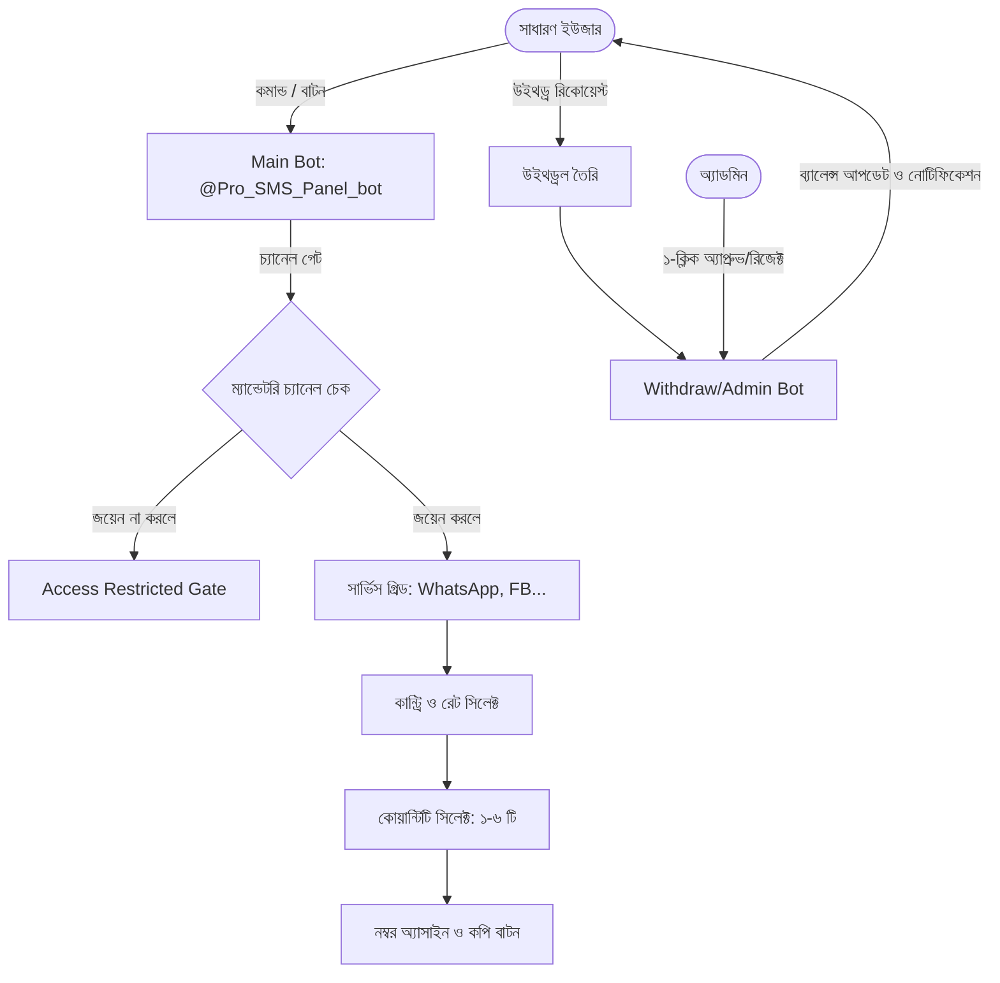
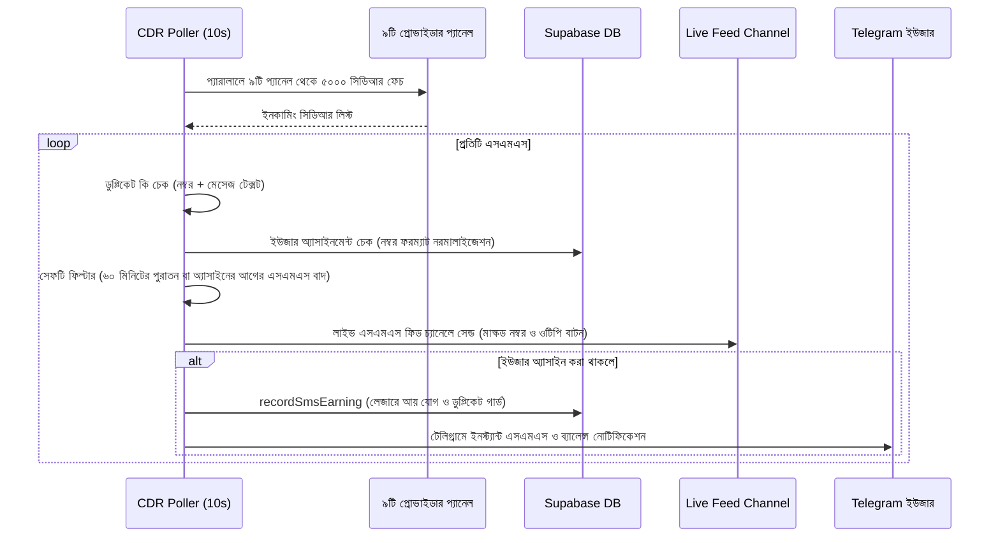

# SMS Hadi Bot — Complete Architecture & Design Blueprint

এই ব্লুপ্রিন্টটিতে **SMS Hadi / Pro SMS Panel** বট সিস্টেমের প্রতিটি কম্পোনেন্ট, ডাটাবেজ আর্কিটেকচার, প্যানেল স্ক্র্যাপার/সেশন সিস্টেম, Telegram বট ফ্লো, SMS সিডিআর পোলিং ও অ্যাকাউন্টিং মেকানিজম বিস্তারিতভাবে রেকর্ড করা হলো—যাতে পরবর্তীতে হুবহু এই ডিজাইনে বা এর চেয়ে উন্নত নতুন বট সহজেই তৈরি করা যায়।

---

## ১. প্রজেক্ট ওভারভিউ ও টেক স্ট্যাক (Tech Stack)

| Component | Technology / Library | Purpose |
| :--- | :--- | :--- |
| **Runtime** | Node.js (CommonJS, `'use strict'`) | মূল ব্যাকএন্ড ও বট ইঞ্জিন |
| **HTTP Server** | Express.js, CORS, dotenv | হেলথ চেক, ডিবাগ এন্ডপয়েন্ট ও ওয়েবহুক |
| **Database** | Supabase (PostgreSQL) + `@supabase/supabase-js` | রিলেশনাল ডাটাবেজ, লেজার ও RPC |
| **HTTP Client** | Axios + `axios-cookiejar-support` + `tough-cookie` | প্যানেল স্ক্র্যাপিং, কুকি/সেশন ও Telegram API |
| **HTML Parser** | Cheerio | PHP প্যানেল থেকে ডেটা ও ক্যাপচা পার্সিং |
| **Bot API** | Telegram Bot HTTP API (Direct Long Polling) | নো-লাইব্রেরি পিওর এইচটিটিপি লং-পোলিং |

---

## ২. ডিরেক্টরি স্ট্রাকচার (Project Structure)

```text
sms-hadi/
├── server.js                      # মূল সার্ভার, CDR Poller, ব্যাকগ্রাউন্ড ক্রন জব ও রুট
├── package.json                   # ডিপেনডেন্সি ও স্ক্রিপ্টস
├── schema.sql                     # সম্পূর্ণ সুপাবেস ডাটাবেজ স্কিমা (টেবিল, ইনডেক্স)
├── backup_runner.js               # ডুয়াল সুপাবেস ব্যাকআপ সিঙ্ক স্ক্রিপ্ট
├── config/
│   ├── supabase.js                # সুপাবেস ক্লায়েন্ট (পাবলিক ও সার্ভিস রোল)
│   └── supabaseBackups.js         # ব্যাকআপ সুপাবেস কানেকশন
├── data/
│   ├── app_services.json          # লোকাল ক্যাশ ও ফলব্যাক সার্ভিসেস
│   └── service_mappings.json      # রেঞ্জ ম্যাপিং লোকাল ফলব্যাক
├── migrations/
│   └── 20260927_referral_system.sql # রেফারেল সিস্টেমের সম্পূর্ণ PostgreSQL RPC
├── scripts/
│   ├── fix_blue_dead_numbers.js   # ডেড নাম্বার ক্লিনার
│   └── recoverBalance.js          # লেজার ট্রানজেকশন রিক্যালকুলেশন
└── services/
    ├── appServiceManager.js       # হাই-লেভেল অ্যাপ সার্ভিস ও রেঞ্জ ম্যাপিং ম্যানেজার
    ├── numberPool.js              # মাল্টি-প্যানেল নাম্বার সিঙ্ক, অ্যাসাইন ও রিলিজ ইঞ্জিন
    ├── rangeNicknameService.js    # প্যানেল রেঞ্জ রিনেম / ডিসপ্লে নেম ওভাররাইড
    ├── referralService.js         # রেফারেল ড্যাশবোর্ড, এলিজিবিলিটি ও মাইলেস্টোন বোনাস
    ├── settingsService.js         # উইথড্র অন/অফ, ফিড টোকেন ও প্যানেল সুইচ সেটিংস
    ├── supabaseAccounting.js      # লেজার ব্যালেন্স, ট্রানজেকশন ও উইথড্রল লাইফসাইকেল
    ├── telegramBotService.js      # ট্রিপল-বট আর্কিটেকচার (মেইন বট + অ্যাডমিন বট + উইথড্র বট)
    │
    │   ── ৯টি প্রোভাইডার প্যানেল API ও সেশন হ্যান্ডলার্স ──
    ├── smshadiApi.js / smshadiSession.js       # Whale (SMS Hadi - PHP DataTables)
    ├── greenSmsApi.js / greenSmsSession.js     # Shark (GreenSMS)
    ├── zyronApi.js / zyronSession.js           # Dolphin (Zyron SMS)
    ├── crabApi.js / crabSession.js             # Crab (Core SMS)
    ├── tigerApi.js / tigerSession.js           # Tiger SMS
    ├── hunterApi.js / hunterSession.js         # Hunter SMS
    ├── ksiSwitchfyApi.js / ksiSwitchfySession.js # King / KSI (Switchfy Scraper)
    ├── routecoreApi.js / routecoreSession.js   # RouteCore SMS
    └── blueSmsApi.js / blueSmsSession.js       # Blue SMS (REST API with JWT)
```

---

## ৩. ডাটাবেজ স্কিমা (Database Architecture)

সুপাবেস ডাটাবেজের কোর টেবিলসমূহ:

### ১. `users`
- `telegram_id` (BIGINT, UNIQUE) — ইউজারের টেলিগ্রাম আইডি (আইডি `0` সিস্টেম সেটিংসের জন্য সংরক্ষিত)।
- `username`, `first_name`
- `balance` (NUMERIC) — রেগুলার প্যানেল উইথড্রয়াল ব্যালেন্স (BDT)।
- `ksi_balance` (NUMERIC) — KSI / King প্যানেল ব্যালেন্স।
- `total_earnings`, `total_withdrawn`, `pending_withdrawal`
- `total_sms` (INT)
- `wallet_address`, `wallet_method` (bKash / Nagad / Binance)
- `selected_panel` (Default: `'whale'`)

### ২. `number_pool`
- `number` (TEXT, UNIQUE) — ফোন নম্বর।
- `range_id`, `range_name` (যেমন: `Bangladesh 880 (Whale)`)
- `country` — দেশের নাম ও ফ্ল্যাগ এক্সট্রাকশন।
- `payout_rate` — পার SMS পেআউট রেট (BDT)।
- `is_assigned` (BOOLEAN) — কোনো ইউজার ক্লেইম করেছে কিনা।
- `telegram_id`, `assigned_at`, `synced_at`

### ৩. `assigned_numbers`
- সক্রিয় নম্বর ট্র্যাকিং (ইউজার নম্বর ক্লেইম করলে এখানে আসে)।
- ২৪ ঘণ্টা পর অটো-ক্লিনআপ জব দ্বারা ক্লিন হয়।

### ৪. `transactions` (Ledger)
- `telegram_id`, `type` (`'EARNING'`, `'WITHDRAWAL'`, `'BONUS'`)
- `amount` (BDT)
- `number`, `cli` (সেন্ডার আইডি), `sms_text`, `provider`, `created_at`

### ৫. `withdrawals`
- `telegram_id`, `amount`, `method`, `wallet_address`, `provider`
- `status` (`'PENDING'`, `'APPROVED'`, `'REJECTED'`)
- `reject_reason`, `requested_at`, `processed_at`

### ৬. `app_services` & `app_service_ranges`
- অ্যাডমিন দ্বারা তৈরি হাই-লেভেল সার্ভিস (WhatsApp, Facebook, Imo, PayPal, ইত্যাদি)।
- ব্যাকএন্ড প্যানেল রেঞ্জের সাথে ম্যাপিং ও কাস্টম BDT রেট নির্ধারণ।

### ৭. `range_nicknames`
- ব্যাকএন্ড রেঞ্জের টেকনিক্যাল নাম ক্লায়েন্টদের থেকে লুকিয়ে সুন্দর নিকনেম দেখানো।

### ৮. `referrals` & `referral_reward_requests`
- ৩০ দিনে ১,০০০টি OTP রিসিভ করলে 'Eligible' হয়।
- ৭০% মেম্বার অ্যাক্টিভ (৭ দিনে ১০০ OTP) থাকলে মাইলেস্টোন রিওয়ার্ড ক্লেইম করা যায় (১০ জনে ৳১,০০০, ২০ জনে ৳২,০০০, ৫০ জনে ৳৫,০০০, ১০০ জনে ৳১০,০০০)।

---

## ৪. মাল্টি-বট সিস্টেম আর্কিটেকচার (Telegram Bot Structure)

বটটি ৩টি আলাদা বটের সমন্বয়ে কাজ করে:



### প্রধান ফিচারসমূহ:
1. **Mandatory Channel Gatekeeper (`checkMustJoin`):**
   - ইউজার অবশ্যই অফিসিয়াল চ্যানেল ও সাপোর্ট গ্রুপে যুক্ত থাকতে হবে।
   - ১ মিনিটের মেমোরি ক্যাশ ব্যবহার করায় টেলিগ্রাম API লিমিট হয় না।
2. **App-Service Based Number Flow:**
   - সার্ভিস নির্বাচন ➔ দেশ/রেট নির্বাচন ➔ কোয়ান্টিটি নির্বাচন (১ থেকে ৬) ➔ এক ট্যাপে কপিযোগ্য বাটন।
3. **Prefix Removal Engine (`stripDialCode`):**
   - ২৪০+ টি দেশের আন্তর্জাতিক ডায়াল কোড দীর্ঘতম-প্রথম অর্ডারে পার্স করে দেশের প্রিফিক্স বাদে লোকাল নম্বর আলাদা করে কপি করার সুবিধা।
4. **Callback Data Session Cache (`_rpStore`):**
   - টেলিগ্রামের ৬৪-বাইট কলব্যাক ডাটা লিমিট এড়াতে নম্বরগুলো মেমোরিতে কি (Key) আকারে সেভ রেখে কলব্যাকে শুধুমাত্র শর্ট কি পাঠানো হয়।
5. **Withdrawal Protection:**
   - মিনিমাম উইথড্র ৳২০ BDT।
   - একটি রিকোয়েস্ট পেন্ডিং থাকা অবস্থায় আরেকটি রিকোয়েস্ট সাবমিট করা ব্লক থাকে।

---

## ৫. সিডিআর ও এসএমএস পোলিং ইঞ্জিন (CDR Poller Engine)

`server.js`-এ থাকা মূল লুপটি প্রতি **১০ সেকেন্ড** পর পর ব্যাকগ্রাউন্ডে চলে:



---

## ৬. প্যানেল সেশন হ্যান্ডলিং মেকানিজম (Provider Session Strategy)

নয়টি প্যানেলে ৩ ধরনের সংযোগ পদ্ধতি ব্যবহার করা হয়েছে:

1. **PHP Web Forms with Captcha (যেমন: SMS Hadi, GreenSMS, Zyron, Crab):**
   - `GET /login` থেকে পেজ লোড ও ক্যাপচা রেজেক্স দিয়ে সমাধান (`What is 5 + 3`).
   - `POST /signin` করে `PHPSESSID` কুকি সেভ রাখা।
   - সেশন মেয়াদ উত্তীর্ণ হলে স্বয়ংক্রিয় রি-লগইন।
2. **REST API with Bearer Token (যেমন: Blue SMS):**
   - `POST /api/v1/auth/login` থেকে JWT অ্যাক্সেস টোকেন গ্রহণ।
   - পেজিনেশন হ্যান্ডলার (৫,০০০ প্রতি পেজ) ব্যবহার করে সব নম্বর ফেচ।
3. **Panel HTML Table Scraping (যেমন: KSI / Switchfy):**
   - Cheerio দিয়ে ড্যাশবোর্ড টেবিল স্ক্যান করে রেট ও নম্বর রিড করা।

---

## ৭. নতুন বট তৈরি করার ক্ষেত্রে অনুসরণযোগ্য চেকলিস্ট

নতুন কোনো বট তৈরি করার সময় এই কোডবেসের নিচের প্যাটার্নগুলো অনুসরণ করতে হবে:
- [x] **State Machine:** ইউজার ও অ্যাডমিনের জন্য `Map()` ভিত্তিক ইনপুট স্টেট হ্যান্ডলিং।
- [x] **Telegram Rate Limit Guard:** মেসেজ পাঠানোর মাঝে ২৫০–৩৫০ms ডিলে রাখা।
- [x] **PostgreSQL Ledger Design:** সরাসরি ইউজারের ব্যালেন্স না বাড়িয়ে সর্বদা `transactions` টেবিলে এন্ট্রি দিয়ে ব্যালেন্স রিক্যালকুলেট করা।
- [x] **Phone Number Normalization:** নম্বরের সামনে `+`, `880`, `0` ইত্যাদি ভ্যারিয়েন্ট হ্যান্ডেল করে নম্বর ম্যাচ করানো।
- [x] **Fallback Layer:** ডাটাবেজ টেবিল কোনো কারণে ডাউন বা মিসিং থাকলে ইন-মেমোরি ও লোকাল JSON ফাইলে ডেটা ব্যাকআপ রাখা।
